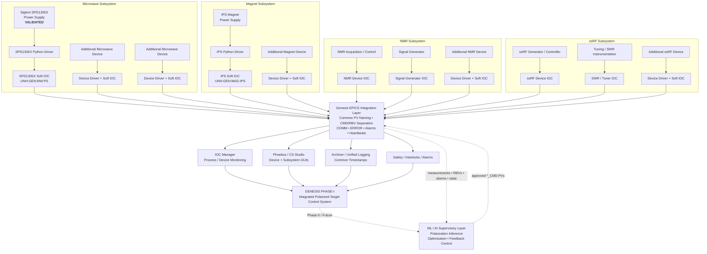

# Genesis Phase-I Integration Architecture

## 1. Purpose

Genesis Phase I is developing a unified EPICS-based control and acquisition architecture for the UNH polarized target laboratory.

The Phase-I system is composed of several major subsystems, including:
- Microwave
- Magnet
- NMR
- ssRF

Each subsystem may contain multiple independently controlled physical devices.
The goal of Phase I is not merely to convert individual LabVIEW controls to Python. The goal is to build device-level controls in a common architecture so that the devices can first be integrated into their respective subsystems and then combined into one coordinated Genesis control system.
After Phase-I integration and validation, a higher level machine learning and AI supervisory layer can interact with the system through EPICS.

---

## 2. System hierarchy

Genesis is organized in four layers:
1. Device
2. Subsystem
3. Integrated Phase-I control system
4. Future ML/AI supervisory system

Conceptually:
Physical hardware
→ device-specific Python driver/controller
→ device EPICS IOC
→ subsystem integration
→ Genesis Phase-I integrated EPICS system
→ future ML/AI supervisory and feedback control

### Architecture principle

The hierarchy is:

**Physical device → device-specific driver → device Soft IOC → subsystem → common EPICS integration → Genesis Phase-I system → future ML/AI supervisory control**

The ML/AI layer does not directly communicate with instrument hardware. It reads system state and issues approved commands through the same EPICS interface used by the rest of Genesis. Device level limits, hardware protections, and interlocks remain authoritative.

---

## 3. Device layer

A device is one independently controlled physical instrument or logical hardware component.

Examples include:
- Siglent SPD1305X power supply within the Microwave subsystem
- IPS magnet power supply within the Magnet subsystem
- signal generators
- RF hardware
- NMR acquisition/control hardware
- vacuum instrumentation
- other subsystem specific devices

Where practical, each independently controlled instrument should have its own IOC.

Each device implementation contains:
- hardware specific Python communication code;
- a device controller/driver;
- a Genesis Device adapter;
- YAML configuration;
- EPICS PV definitions;
- communication health reporting;
- a device level Phoebus screen;
- appropriate safety checks.

Hardware specific details remain inside the device layer.

---

## 4. Subsystem layer

Multiple device IOCs are grouped into a functional subsystem.

Examples:

### Microwave subsystem

The current Phase-I Microwave subsystem contains:

- Siglent SPD1305X UCA power-supply IOC;
- Vaunix / Bridge12 microwave-source IOC;
- Microwave Supervisor IOC;
- PCL602 positioning-robot IOC.

The subsystem overview is `gui/genesis_microwave.bob`, with dedicated Supervisor, SPD1305X, Vaunix, and Robot detail screens.

Normal RF/frequency operation is routed through the Microwave Supervisor. Raw source and robot-motion interfaces remain commissioning-level controls until physical validation is complete.

All four Microwave components participate in the common Genesis IOC Manager and common archiving architecture. Device/subsystem archive records and IOC heartbeat PVs use the same timestamped CSV path used by the rest of Genesis.

Additional Microwave devices can still be added without changing the device/subsystem architecture.

### Magnet subsystem

The Magnet subsystem will include the magnet power supply and any additional devices required for magnet operation and monitoring.

### NMR subsystem

The NMR subsystem may include NMR acquisition/control hardware, signal generation, and related instruments.

### ssRF subsystem

The ssRF subsystem may include the RF generator/controller, tuning and SWR instrumentation, and other required hardware.
Each subsystem may therefore contain several device-level IOCs.

---

## 5. EPICS namespace

The standard namespace is:

UNH:GEN:<SUBSYSTEM>:<DEVICE>:<PV>

For example:
UNH:GEN:MW:PS:VSET_CMD
UNH:GEN:MW:PS:VSET_RBV
UNH:GEN:MW:PS:VMEAS

Here:
UNH
    Laboratory/institution scope
GEN
    Genesis system
MW
    Microwave subsystem
PS
    Power-supply device role
VSET_CMD
    Device PV

The logical device role is used in the EPICS namespace rather than permanently encoding a particular manufacturer/model into higher level interfaces.
This allows physical hardware to be replaced later without unnecessarily changing subsystem, archiver, GUI, or supervisory interfaces.
The specific hardware model remains documented in the device implementation, configuration, and device level GUI.

---

## 6. Command, readback, and measurement convention

Where applicable, device PVs distinguish requested state from confirmed hardware state.

Use:
*_CMD
    Command requested by an operator or supervisory system.
*_RBV
    Value or state reported back by the physical device.
*MEAS
    Direct measured physical quantity.

Example:
VSET_CMD
    requested voltage setpoint
VSET_RBV
    voltage setpoint reported by the hardware
VMEAS
    measured output voltage

This separation is important for subsystem coordination and future automated control.

---

## 7. Communication health

Each device IOC should expose standard communication-health information.

COMM
    Hardware communication state.
ERROR
    Operator readable communication or command error.
MAN:<device>_time
    Timestamp associated with the most recent successful device read.

If hardware communication fails:
- the IOC should remain available when possible;
- COMM should indicate the hardware failure;
- ERROR should report the failure;
- affected readbacks should enter an appropriate EPICS communication alarm;
- the last-good-read heartbeat may stop advancing.

This allows IOC Manager and higher-level supervisory software to distinguish an IOC/process failure from an instrument communication failure.

---

## 8. Commissioning and write safety

The standard commissioning defaults are:
write_enabled: false
initialize_on_connect: false

With writes disabled, hardware changing commands are rejected.
With automatic initialization disabled, merely connecting to a device does not change the instrument state.
Writes are deliberately enabled only during controlled commissioning or approved operating modes.
Safety must not rely only on the Phoebus GUI.

Appropriate safeguards may exist at several levels:
- physical hardware protections;
- instrument protections;
- hardware interlocks;
- device-driver limits;
- IOC safety logic;
- EPICS alarms;
- supervisory logic.

---

## 9. Phoebus / CS Studio

Phoebus communicates with devices through EPICS PVs. Device level screens represent individual instruments. Subsystem level screens may later aggregate several device screens. Control widgets use command PVs. Displays use hardware readbacks or measured PVs. The GUI must not directly open TCP, serial, GPIB, USB, or other hardware connections.

---

## 10. IOC management

Device IOCs should ultimately be launched and monitored through the common Genesis IOC-management system rather than manually starting each Python process.

IOC management should provide:
- device start/stop control;
- process status;
- last-good-read or heartbeat monitoring;
- device identification;
- failure visibility;
- consistent startup procedures.

Failure of one device IOC should not require unrelated device IOCs or subsystems to stop.

---

## 11. Logging and archiving

All Genesis subsystems should use a common timestamp basis.
Device and subsystem data should be archived in a form that allows events across Magnet, Microwave, NMR, ssRF, and later ML/AI control to be correlated.
Where practical, unified timestamped logging should be preferred over independent uncorrelated logs.

---

## 12. Phase-I integration

Phase I proceeds incrementally.

First:
Device hardware communication
→ read-only commissioning
→ controlled writes
→ EPICS integration
→ device-level Phoebus interface

Then:
Multiple devices
→ subsystem integration

Then:
Microwave + Magnet + NMR + ssRF
→ complete Genesis Phase-I integrated system

Subsystem integration should therefore be considered while individual devices are developed, rather than postponed until every device is finished.

---

## 13. Future machine learning and AI layer

The ML/AI layer is added after the underlying Phase-I control architecture is validated.
The ML layer should interact with the experimental system through EPICS rather than bypassing device IOCs.

It may consume:
- NMR data and inferred polarization;
- magnet state;
- microwave state;
- ssRF state;
- subsystem measurements;
- alarms;
- communication state;
- experiment history.

It may later issue approved commands through EPICS command PVs.

Conceptually:
Device hardware
→ device IOCs
→ subsystem integration
→ Genesis EPICS control layer
→ ML/AI supervisory layer
→ approved EPICS command PVs
→ device IOCs
→ hardware

Device level safety logic remains authoritative over ML-generated requests.

---

## 14. First device level reference implementation

The first fully validated Genesis Phase-I device implementation is the:
Siglent SPD1305X power supply
within the:
Microwave subsystem

Its current EPICS namespace is:
UNH:GEN:MW:PS

It demonstrates:
- TCP/SCPI hardware communication;
- Python device control;
- pythonSoftIOC integration;
- command/readback separation;
- communication loss detection;
- automatic reconnection;
- read-only commissioning;
- controlled hardware writes;
- protection setting access;
- output control;
- Genesis PV naming;
- device level Phoebus integration.

The SPD1305X implementation is a device level reference pattern. It is not the complete Microwave subsystem. Additional Microwave devices will be integrated alongside it using the same
overall architecture.

---

## 15. Integration principle

Genesis devices do not need identical hardware implementations. They do need compatible integration behavior. Hardware specific complexity remains at the device layer. EPICS provides the common interface that allows individual devices to become subsystems, subsystems to become the integrated Phase-I system, and the integrated system to later support machine learning and AI-assisted control.

## Final ssRF physical ownership boundary

Final ownership:

    SMC100A IOC          → SMC100A
    Keysight WaveGen IOC → Keysight WaveGen
    NMR switch IOC       → receiver-protection switch
    ssRF switch IOC      → burn-path switch
    Interlock            → safety decisions only
    Sequencer            → coordinated execution only
    Fitter / Burn Setup  → analysis and waveform planning only

No legacy/demo IOC participates in final physical operation.

See `SSRF_FINAL_PHYSICAL_OPERATION.md`.
